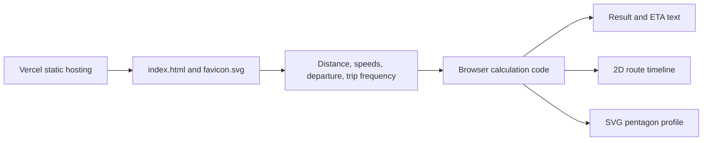

# Speedwise

**A trip-time calculator that makes the minutes visible.** Speedwise compares a steady-speed estimate with a faster alternative, then shows the difference as arrival times, a left-to-right route timeline, and a five-axis trip profile.

[Open Speedwise](https://speed-wise.vercel.app)

## What it does

Enter a destination distance, your current cruising speed, and an additional speed increase. Speedwise calculates the travel time for both speeds and estimates how much sooner the faster scenario reaches the same destination.

The interface is designed around the comparison itself: a bold result, two arrival estimates, a proportional route timeline, and a pentagon chart that describes the trip inputs. The chart is a trip profile, not a score.

## Features

- **Distance and speed units:** Switch between kilometres and miles. Current speed, speed increase, distance, labels, and chart limits convert together.
- **Live comparison:** Edit the distance, current speed, or speed increase and see both travel times and saved time update immediately.
- **Speed slider:** Adjust the speed increase with a slider or enter an exact value.
- **Sample trips:** Load quick-trip, day-trip, and long-drive examples, then edit them freely.
- **Arrival estimates:** Set an optional local departure time to see an estimated arrival at each speed, including when the estimate rolls into the next day.
- **Repeat-trip outlook:** Set how many similar trips you make per week. Speedwise estimates weekly savings, a monthly average, and a 52-week annual total.
- **Route timeline:** Compare the two travel durations on a shared, left-to-right scale. The shorter line ends earlier at the same destination.
- **Five-measure profile:** A pentagon chart compares distance, current speed, faster speed, time saved, and percentage of travel time reduced. Each axis has its own reference limit; exact values and limits appear beside the chart.
- **Copy and reset:** Copy a plain-text estimate or restore the example trip.
- **Responsive and keyboard-friendly:** The layout adapts to small screens, controls have labels, keyboard focus is visible, and reduced-motion preferences are respected.

## How the calculation works

For distance `d` and current speed `v`:

```text
current travel time = d / v
faster speed        = v + speed increase
faster travel time  = d / (v + speed increase)
time saved          = current travel time - faster travel time
percent reduced     = time saved / current travel time × 100
```

Travel times are converted to minutes for display and rounded to the nearest minute. Arrival estimates add those minutes to the departure time entered in the user's local clock. Weekly savings multiply per-trip savings by the trip frequency. Monthly savings use `52 / 12` weeks, and annual savings use 52 weeks.

The route timeline scales the faster trip's line by `faster travel time / current travel time`. The pentagon chart normalizes each value against the limits shown next to its measure: 500 km or 300 mi for distance, 160 km/h or 100 mi/h for speed, 120 minutes for time saved, and 50% for time reduced. Values above a limit are clipped to the chart edge.

These are planning estimates. The model assumes constant speeds and does not account for traffic, acceleration, road type, speed limits, stops, weather, or other route conditions. A higher speed is not a recommendation to exceed posted limits or drive unsafely.

## How the app is built

Speedwise is a small static web application. It has no application server, user account system, database, or API that receives trip inputs.



### Runtime flow

1. Vercel serves `index.html` and `favicon.svg` as static files.
2. The browser reads the form controls and calculates the current estimate in JavaScript.
3. The same result values update the summary, arrival estimates, route timeline, weekly/monthly/yearly forecast, and SVG chart.
4. Changing units converts the current distance and speeds before recalculating. Sample buttons load a set of example inputs in the selected units.
5. Copying a summary uses the browser Clipboard API. Reset restores the default example.

Trip inputs are held in page memory while the page is open. The calculator does not write them to local storage or send them to a Speedwise backend. The page includes Vercel Analytics and Speed Insights scripts for site-level analytics and performance measurement; those are separate from the calculator's trip calculations.

### Repository layout

| File | Responsibility |
| --- | --- |
| `index.html` | Page structure, neo-brutalist design system, calculator logic, arrival estimates, route timeline, and SVG chart. |
| `favicon.svg` | Small Speedwise mark using the same black-and-green visual identity. |
| `assets/fonts/space-grotesk-latin.woff2` | Locally served variable font for interface text and the wordmark; the display headline retains its condensed display face. |
| `assets/fonts/OFL.txt` | SIL Open Font License for the bundled Space Grotesk font. |
| `README.md` | Product behavior, calculation model, architecture, and development notes. |
| `package.json` | Project metadata, validation and local-server commands, and Vercel analytics package declarations. |
| `scripts/check-inline-js.mjs` | Lightweight check that inline JavaScript parses and required interface hooks exist. |

There is no frontend framework or build step. CSS, HTML, and browser JavaScript are kept together in `index.html` so the static deployment remains easy to inspect and maintain. The pentagon visualization is native SVG; no chart package is required.

## Design system

The current interface uses a warm paper background (`#f4f1e7`), near-black ink (`#10110d`), and the Speedwise green accent (`#b8f36b`). Thick black rules, square controls, large type, and hard offset shadows draw from the supplied neo-brutalist references. Green marks the faster scenario and key result areas; it is not used as a decorative background everywhere.

Space Grotesk is bundled as a variable WOFF2 for the wordmark and interface text, with its SIL Open Font License included in `assets/fonts/OFL.txt`. The condensed display face remains reserved for the main headline. Fonts are served locally rather than fetched from a third-party host. Motion is limited to short updates in the route visualization and respects `prefers-reduced-motion`.

## Run locally

Requirements: Node.js for the lightweight validation script and Python 3 for the optional static server.

```sh
npm test
npm run serve
```

Then open `http://localhost:4173`. The HTML can also be opened directly in a browser, although clipboard access generally requires a secure context such as HTTPS or localhost.

`npm test` parses the inline JavaScript and checks that key calculator elements and the favicon are present. It does not replace a browser-based visual or accessibility audit.

## Deployment

The production-facing Vercel address is [speed-wise.vercel.app](https://speed-wise.vercel.app). The project is configured as a static site served from the repository root; no build output is generated.

The alternate custom domain `speed-wise.bursale.app` is attached to the Vercel project. Vercel previously reported its DNS as unconfigured and recommended this CNAME record:

- **Name:** `speed-wise`
- **Target:** `24389b687d6b32e5.vercel-dns-017.com`

The DNS provider must publish the record before that alternate hostname can resolve correctly. Check the Vercel project domain settings for the current status.

## Suggested GitHub repository metadata

- **Description:** Neo-brutalist browser-based trip time calculator with interactive travel comparisons and statistics.
- **Topics:** `speedwise`, `travel-time-calculator`, `trip-planning`, `arrival-estimates`, `time-savings`, `vanilla-javascript`, `vercel`, `neo-brutalist-ui`.
